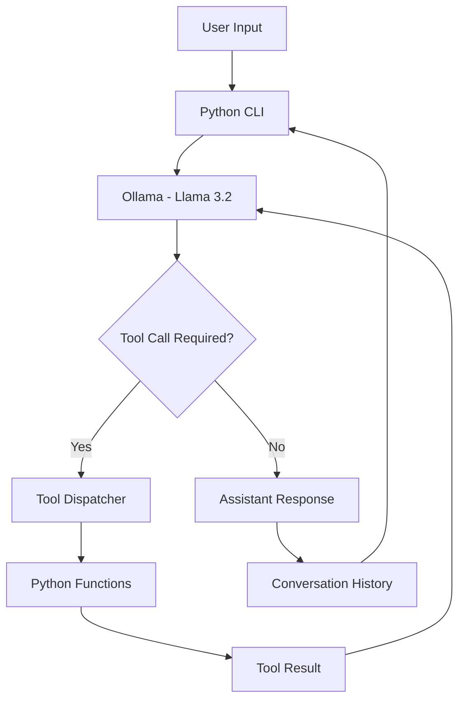

# Local AI Assistant with Ollama

A locally hosted AI assistant built with **Python**, **Ollama**, and **Llama 3.2 (3B)**. The assistant uses LLM function calling to interact with the local file system, execute shell commands with user confirmation, and maintain conversation history through a command-line interface.

## Features

- **Local LLM:** Runs Llama 3.2 (3B) locally using Ollama, without requiring a cloud API.
- **Function Calling:** Allows the model to select and execute predefined Python functions.
- **File Management:** Create, read, write, append, and list files and directories.
- **Command Execution:** Execute shell commands after explicit user confirmation.
- **Conversation History:** Maintains previous messages and tool results throughout the session.
- **Personalisation:** Users can set their preferred name.
- **Multi-Step Tool Calling:** Supports multiple tool calls to complete more complex requests.
- **Error Handling:** Handles invalid tool calls, file errors, and command execution failures.

## Technologies Used

| Technology | Purpose |
|---|---|
| Python | Application logic and tool execution |
| Ollama | Local LLM inference and function calling |
| Llama 3.2 (3B) | Language model |
| prompt_toolkit | Interactive command-line input |
| JSON | Tool definitions and structured responses |
| subprocess | Local command execution |
| os | File system operations |

## Prerequisites

Before running the project, ensure you have:

- Python 3.10 or later
- [Ollama](https://ollama.com/) installed and running
- pip (Python package manager)
- Llama 3.2 (3B) downloaded locally

## Installation

**1. Clone the repository**

```bash
git clone https://github.com/YOUR_USERNAME/YOUR_REPOSITORY.git
cd YOUR_REPOSITORY
```

**2. Create and activate a virtual environment**

Windows:

```bash
python -m venv .venv
.venv\Scripts\activate
```

macOS/Linux:

```bash
python3 -m venv .venv
source .venv/bin/activate
```

**3. Install dependencies**

```bash
pip install ollama prompt_toolkit
```

**4. Download the language model**

```bash
ollama pull llama3.2:3b
```

Ensure Ollama is running before starting the application.

**5. Run the assistant**

```bash
python main.py
```

Replace `main.py` with your Python script's filename if different.

## Available Tools

The assistant can access the following Python functions:

| Tool | Description |
|---|---|
| `set_user_name` | Updates the user's preferred name |
| `make_directory` | Creates a new directory |
| `read_file` | Reads the contents of a text file |
| `write_file` | Creates or overwrites a text file |
| `append_file` | Appends content to an existing file |
| `list_files` | Lists files and directories |
| `run_commands` | Executes shell commands with user approval |

## How It Works

The assistant uses a tool-calling architecture in which the language model determines whether a user's request requires a Python function.

1. The user enters a message through the CLI.
2. The message is sent to Ollama alongside conversation history and available tool definitions.
3. The LLM either generates a response or requests one or more tool calls.
4. Requested tools are matched to Python functions through a tool registry and dispatcher.
5. The functions execute and return structured results.
6. Tool results are added to conversation history and sent back to the model.
7. The process continues until the model generates a final response or reaches the tool-call limit.

### Architecture



## Example Usage

**File Creation**

```text
user: Create a file called notes.txt containing my shopping list.

[Tool requested: write_file]

BOT: I've created notes.txt with your shopping list.
```

**Reading Files**

```text
user: Read the contents of notes.txt.

[Tool requested: read_file]

BOT: Here are the contents of notes.txt...
```

**Changing User Name**

```text
user: Call me Alex.

[Tool requested: set_user_name]

Alex:
```

**Command Execution**

```text
user: Show me my Python version.

[Tool requested: run_commands]

WARNING: COMMAND REQUESTED BY MODEL
python --version

Run this command? [Y/N]: y

BOT: Your Python version is ...
```

These are illustrative examples; actual responses depend on the model and local environment.

## Safety Considerations

The assistant has access to local file operations and command execution, which can modify the user's system.

- Shell commands require explicit user confirmation before execution.
- The tool dispatcher prevents execution of unregistered Python functions.
- File writing can overwrite existing content without additional confirmation.
- File access is currently limited by the permissions of the Python process, not by a dedicated workspace.
- Users should review proposed commands carefully before approving them.

**Warning:** Run this application in a controlled environment. Avoid granting unnecessary system permissions.

## Project Limitations

- Conversation history is stored in memory and is lost when the application closes.
- The 3B parameter model may occasionally select incorrect tools or generate invalid arguments.
- Tool execution is synchronous.
- There is no graphical user interface.
- File access is not restricted to a sandbox directory.
- Complex shell commands may not be supported by the command execution function.

## Future Improvements

- [ ] Add persistent conversation history using JSON or SQLite.
- [ ] Implement a file-system sandbox to restrict file access.
- [ ] Add confirmation before overwriting existing files.
- [ ] Improve validation of LLM-generated tool arguments.
- [ ] Introduce safer command execution using an allowlist.
- [ ] Add more tools and external API integrations.
- [ ] Develop a web interface.
- [ ] Add automated testing for tool execution and error handling.

## Learning Objectives

This project explores several concepts used in AI agent development:

- Integrating local large language models into Python applications.
- Defining tools using JSON schemas.
- Implementing function calling and tool dispatching.
- Managing multi-step